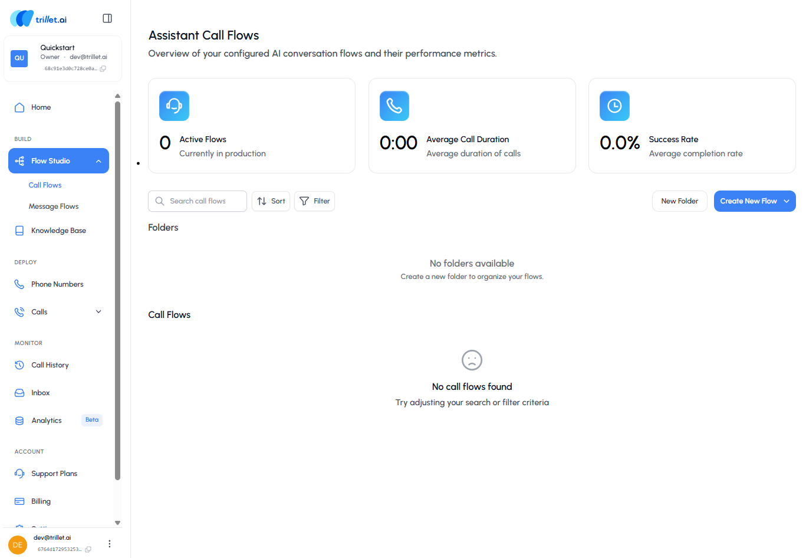
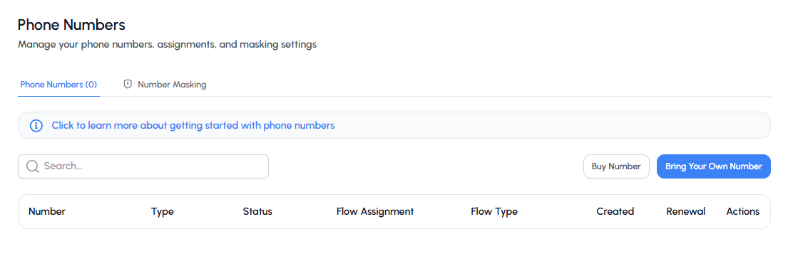
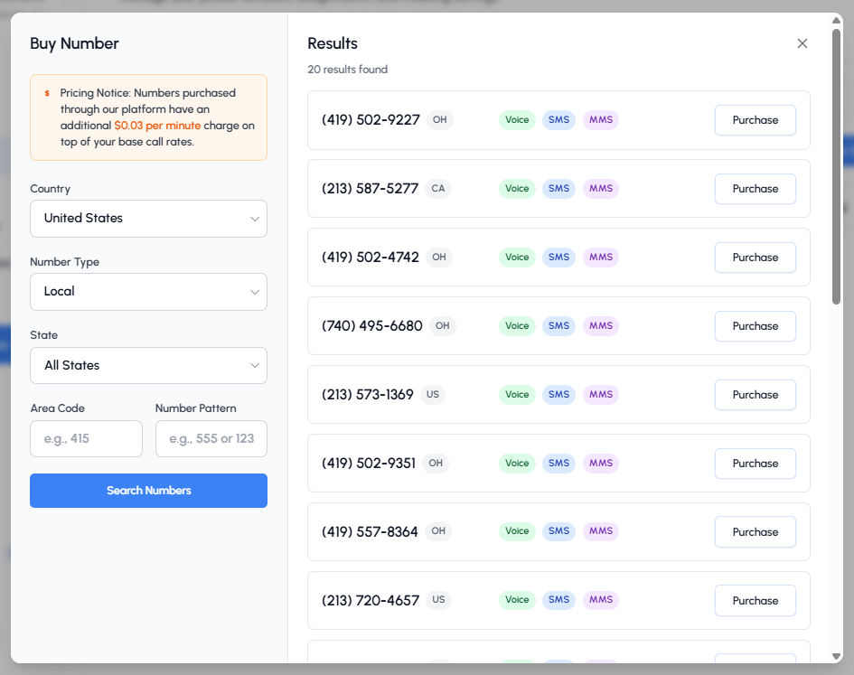
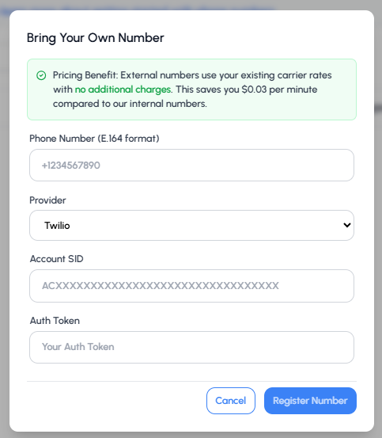
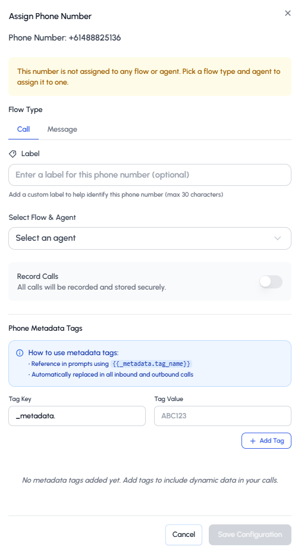

This guide walks you through building your first AI phone agent in the Trillet dashboard. You will create a call flow, write and test the prompt, assign a phone number, place single and batch calls, and set up transfers to your team. If you would rather build with code, see the [REST API reference](/v1/api-reference/introduction) or [build from an AI assistant over MCP](/mcp).

## Getting Started

Once you sign in, you'll land on your dashboard. The sidebar on the left is always visible and groups the app into sections:

- **BUILD**: Assistant, Call Flows, Message Flows, Crews, Workflows, Knowledge Base
- **DEPLOY**: Phone Numbers, Calls (Single Call, Batch Calls, Call Queues)
- **MONITOR**: Call History, Conversations, Analytics and more
- **ACCOUNT**: Billing and Settings

Some items only appear on certain plans. To build an AI phone agent, start with a call flow: in the sidebar, click **Call Flows**. (Text agents for SMS and chat live under **Message Flows**.)

### Understanding Call Flows

A call flow is the backbone of your AI agent. It holds the agent's instructions, voice, language model, greeting, tools and call settings, and it decides whether the agent makes calls, answers them, or both. You can think of it like a blueprint for your agent's calls.




- Your call flows are listed on this page for quick access
- You can group them into folders to keep your work organized

To begin building your first flow, click **New Call Flow**.

## 1.1 Create a Call Flow

**New Call Flow** opens a short wizard that asks, "What agent would you like to build today?" You have three ways to start:

- **Start from a template** (recommended). Templates are grouped into agents that **answer incoming calls** and agents that **make outgoing calls**, for example a receptionist or a booking agent. Picking one moves you straight to the next step.
- **Start from scratch**. Skips the wizard and opens an empty call flow editor where you write the prompt yourself.
- **Advanced** (Alpha, where available). Builds a node flow for multi-step logic, parallel API calls and custom code.

If you pick a template, the wizard has two more steps:

1. **Business**: "Whose calls will it handle?" Enter the business's website and Trillet reads it, or type the details in yourself if there's no website.
2. **Capabilities**: "What should it handle?" Tick what the agent should do on a call, such as answering questions, booking appointments or transferring to a human. Then click **Create agent**.

Trillet generates the agent and opens it in the call flow editor.

<Note>
The direction you pick in the wizard can be changed later. In the editor, open **Settings > Greeting & Conversation > Call direction** and choose inbound, outbound or both.
</Note>

## 1.2 Prompting Your Agent

The call flow editor has three parts:

- **Agent Instructions** on the left: the prompt the agent follows. Its toolbar holds the **language model** picker, the **voice** picker (voice, language, speaking speed and a fallback voice), **Variables** and **Prompt history**.
- **Settings** and **Tools** in the middle: greeting, call handling, phone line, knowledge base, transfers, webhooks and the rest of the flow's settings.
- **Test** on the right: try the agent before it goes live.

The way you prompt your agent determines how well it performs during conversations. Think of it like giving instructions to a teammate before they step into a meeting: the clearer and more specific you are, the better they'll handle the interaction.

You can also choose how your agent starts the call under **Settings > Greeting & Conversation**: let the caller speak first, or have the agent open with a greeting. The same page sets the agent's name, the greeting delay and whether callers can interrupt the greeting.

### Writing Effective Prompts

A strong prompt usually includes:
- **A clear goal** → what is the agent trying to achieve on this call?
- **Background context** → who is the agent, and what key details should they know?
- **Conversation flow** → the step-by-step path the agent should follow to reach the goal

**Example Prompt Structure:**
If your agent's goal is to qualify leads for a demo, your prompt might:
- Set the goal as confirming interest and booking a demo slot
- Provide background context like "You are Alex, a friendly sales assistant from Acme Software"
- Outline a conversation flow where the agent greets the lead, confirms their availability, and suggests two demo times

If you started from a template, the generated prompt already follows this structure. Edit it to fit your business.

### Testing Your Agent

Use the **Test** panel on the right of the editor, headed **Try your agent**:

- **Start test call** runs the agent in a voice call in your browser, so you can hear how it sounds.
- **Test by text instead** lets you chat with the agent and review its replies in writing.

The test runs your **draft**, including changes you haven't published yet.

<Note>
It's always a good idea to test your prompt with different variations to see what gives you the most natural results.
</Note>

### Publishing Your Changes

Edits in the call flow editor save automatically to a **draft**. Live callers, your phone numbers and your website widget keep using the published version until you click **Publish Changes** in the editor's header. Publish whenever you're happy with a change, and before you assign a phone number or place real calls. The header also has **Version history** and **Discard draft** if you want to go back.

## 1.3 Assigning a Phone Number

When you're ready to take your AI agent live, it needs a phone number that people can call. Assigning a number connects your agent to the outside world, so it can handle real conversations instead of just test runs.

In the sidebar, click **Phone Numbers**.




### Number Options

The Phone Numbers page gives you three ways to get a number:

**1. Buy a Number**
- Purchase directly through the platform
- Search by country, number type, and area code or region where available




**2. Connect WhatsApp**
- Connect a WhatsApp Business number so the agent can take WhatsApp calls
- Transfers aren't available on WhatsApp calls yet

**3. Bring Your Own**
- Link an existing number from a provider such as Twilio, Telnyx or your own SIP trunk
- Keep using your existing carrier rates
- Manage everything from within Trillet




### Number Assignment

Once you have a number, open its settings from the Phone Numbers list to assign it:




Configuration options include:
- **What should this number do?**: handle calls or handle messages
- **Choose an AI Agent**: the agent (call flow) the number connects to
- A label for the number, such as "Sales Line"
- Call recording and business hours for this number
- Custom tags (metadata) and secrets the agent can use during the call

The maximum call length is a call flow setting, not a number setting. Set it in the editor under **Settings > Call Handling > Call limits > Maximum call length**.

When everything is configured and your call flow is published, your number is live. Make a quick test call to confirm everything works as expected.

## 1.4 Sending and Receiving Calls

Once a phone number is assigned to your AI agent, it answers incoming calls (if the call flow accepts inbound calls) and can place outgoing ones.

### Single Calls

To place one outbound call: in the sidebar, go to **Calls > Single Call**.

Under **Agent**, choose the agent to make the call (it needs a phone number assigned), enter the number to call under **Phone Number**, and click **Start Call**.

You can also use our [Voice Calls API](/v1/api-reference/endpoints/calls/initiate-call) to programmatically initiate calls:

```bash
curl -X POST https://api.trillet.ai/v1/api/call \
  -H "x-api-key: YOUR_API_KEY" \
  -H "x-workspace-id: YOUR_WORKSPACE_ID" \
  -H "Content-Type: application/json" \
  -d '{
    "call_agent_id": "your_agent_id",
    "to": "+1234567890"
  }'
```

### Batch Calls

Trillet also gives you the ability to place batch calls. To access this feature: in the sidebar, go to **Calls > Batch Calls**.

Batch Calls let you reach multiple contacts at once instead of dialing them individually. This is especially helpful for:
- Lead reactivation campaigns
- Appointment reminders
- Survey collection
- Follow-up calls

**Setup Process:**
1. Choose the agent that will make the calls
2. Click **Download Template** for the CSV format, then **Upload Contact List** with your contacts
3. Start now, or schedule when the calls should go out
4. Click **Start Batch Call**
5. Track earlier batches under **Past Batches**

Defaults such as concurrency live in **Settings > Batch Call Settings**.

<Tip>
For large-scale operations, consider using our [Batch Calls API](/v1/api-reference/endpoints/calls/batch/overview) to programmatically manage batch calls and monitor their status.
</Tip>

## 1.5 Setting up Transfers

Transfers let your agent hand a call over to a real person or another system when needed. This is useful for situations where the conversation requires human support, a specialized team, or a different department.

### Transfer Setup Steps

1. In the call flow editor, open **Settings > Tools** and click **+ Add**
2. Choose **Call transfer** to send the caller to a person or phone number, or **Agent transfer** to hand the call to another of your AI agents
3. Give the transfer a **Name** (e.g., Support Team)
4. Fill in **When should the agent transfer?** in plain English. Be specific: the agent reads this to decide when to transfer
5. Under **Transfer to**, enter the destination, such as a phone number in E.164 format (`+12025550123`). Warm and whisper transfers also accept other destination types, such as a SIP address, under **Advanced type**
6. Pick a **Hand-off style** (see below)
7. Optionally set what the caller hears before the agent dials, and a **Transfer greeting** your team hears when they pick up

Each transfer appears as a card under **Tools > Transfers**. Click a card to edit it. Publish your changes to make new transfers live.

### Hand-off Styles

- **Cold**: connects the caller straight away, with no briefing for your team
- **Warm** (recommended): the agent tells your team who's calling and why as it connects; the call goes through either way
- **Whisper**: the caller waits while the agent speaks privately with your team, who can accept or decline the call

<Warning>
Make sure to test your transfer destinations to ensure they're properly configured and accessible.
</Warning>

## API Integration

Throughout this guide, we've focused on the visual interface, but every feature is also available through our comprehensive REST API:

<Columns cols={2}>
  <Card
    title="Call Agents API"
    icon="robot"
    href="/v1/api-reference/endpoints/agents/call/create"
  >
    Create and manage conversational agents programmatically
  </Card>
  <Card
    title="Call Flows API"
    icon="diagram-project"
    href="/v1/api-reference/endpoints/flows/call-flows/create"
  >
    Design conversation flows via API
  </Card>
  <Card
    title="Voice Calls API"
    icon="phone"
    href="/v1/api-reference/endpoints/calls/initiate-call"
  >
    Initiate and manage calls programmatically
  </Card>
  <Card
    title="Conversations API"
    icon="comments"
    href="/v1/api-reference/endpoints/conversations/generateMessage"
  >
    Handle real-time conversations
  </Card>
</Columns>

## Next Steps

Now that you've set up your first AI agent, explore these advanced features:

<Columns cols={2}>
  <Card
    title="Analytics & Monitoring"
    icon="chart-line"
    href="https://app.trillet.ai/calls/analytics"
  >
    Track performance and optimize your agents
  </Card>
  <Card
    title="Advanced Prompting [Soon!]"
    icon="wand-magic-sparkles"
  >
    Learn advanced prompting techniques for better conversations
  </Card>
  <Card
    title="Platform Integrations"
    icon="webhook"
    href="/documentation/platform-integrations"
  >
    Connect your agent to external systems
  </Card>
</Columns>

## White-label

<Note>
Trillet supports white-label for agencies and enterprises that offer AI voice agents under their own name: your own domain, branded email notifications and workspaces in your brand. Set it up under [Settings](https://app.trillet.ai/settings).
</Note>

## Support & Resources

<Columns cols={3}>
  <Card
    title="API Documentation"
    icon="book"
    href="/v1/api-reference/introduction"
  >
    Complete API reference and examples
  </Card>
  <Card
    title="Community"
    icon="users"
    href="https://www.skool.com/trillet-ai"
  >
    Join our developer community
  </Card>
  <Card
    title="Support"
    icon="headset"
    href="https://app.trillet.ai/support-plans"
  >
    Get a support plan for direct technical help and guidance
  </Card>
</Columns>
